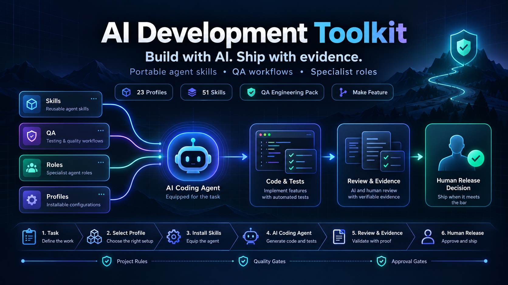
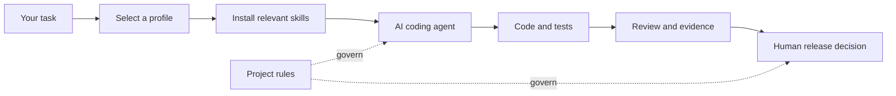

<div align="center">



**Build with AI. Ship with evidence.**

A curated, portable collection of agent skills, specialist roles and practical workflows for AI-assisted software development.


[](https://github.com/MikeMoore1337/ai-development-toolkit/actions/workflows/validate.yml)

**English** · [Русский](README.ru.md) · [Пошаговый старт на русском](docs/ru/GETTING_STARTED.md)

[Use Toolkit for any task](AGENT_START.md) · [Start without a terminal](docs/BEGINNER_START.md) · [Beginner workflow](docs/BEGINNER_WORKFLOW.md) · [Clear Voice guide](docs/CLEAR_VOICE_INTEGRATION.md) · [Make Feature guide](docs/MAKE_FEATURE_INTEGRATION.md) · [English translations of RU originals](docs/en/ADAPTATION.md) · [Languages and translation coverage](docs/LANGUAGE_POLICY.md) · [Curated Backend, Frontend, QA, Agent Engineering and Research packs](docs/CURATED_SKILL_PACKS.md) · [Maintenance & Support](docs/MAINTENANCE_SUPPORT.md) · [DevOps & Infrastructure](docs/DEVOPS_INFRASTRUCTURE.md) · [Accessibility QA](docs/ACCESSIBILITY_QA.md) · [Business & System Analysis](docs/BUSINESS_SYSTEM_ANALYSIS.md) · [UX/UI Design](docs/UX_UI_DESIGN.md) · [Getting started](#quick-start) · [Explore skills](docs/SKILLS_CATALOG.md) · [Installation guide](docs/INSTALLATION.md) · [Contributing](CONTRIBUTING.md) · [Roadmap](docs/ROADMAP.md)

</div>

---

## Why this toolkit?

**Already have a project open in an IDE with Codex?** Simply ask: "Use https://github.com/MikeMoore1337/ai-development-toolkit to complete this task in my current project." [Toolkit is a reference source](AGENT_START.md), **never a storage destination for another user's files or reports**. Code, tests and requested report files belong in the user's project or another chosen destination, never in Toolkit. Installing Toolkit in the user's project is optional.

AI can produce code quickly. Getting the **right change**, validating its behaviour and delivering it safely still requires a repeatable process. This toolkit supplies reusable instructions and focused workflows - without imposing a whole framework on your application.

| What you need | What you get |
| :--- | :--- |
| **Purposeful changes** | Task scoping, architecture decisions and minimal-safe-change guidance |
| **Trustworthy testing** | Test design, meaningful assertions, CI failure analysis and release gates |
| **Consistent interfaces** | Design-system consistency, screenshot fidelity and motion review |
| **Coordinated UI audit** | UX/UI Design Orchestra: read-only design critique, one proposal and plan before visual approval |
| **Better writing** | Clear Voice for precise, natural technical and product communication |
| **End-to-end feature work** | Make Feature 0.3.0 and feature-delivery workflows, **selected one at a time** |
| **Portable installation** | Curated profiles, preview before writing and protection against overwrites |

## What's inside?

| Collection | Contents | Explore |
| :--- | :--- | :--- |
| **Core skills** | 24 skills for planning, implementation, review, security, UI and editorial work | [Browse core](docs/SKILLS_CATALOG.md#core-skills) |
| **Frontend / Backend / Fullstack** | 14 optional, framework-neutral engineering skills | [Engineering guide](docs/UNIVERSAL_ENGINEERING.md) |
| **QA Engineering Pack** | 27 optional skills for API, UI, contract and integration tests, CI, reliability and release evaluation | [Browse QA pack](docs/SKILLS_CATALOG.md#qa-engineering-pack) |
| **Make Feature** | 1 optional, self-contained workflow skill for feature delivery | [Integration](docs/MAKE_FEATURE_INTEGRATION.md) |
| **Agent roles** | 5 core + 11 specialist QA reference roles | [Browse roles](docs/SKILLS_CATALOG.md#agent-roles) |
| **Install profiles** | 43 task-focused selections | [Choose a profile](docs/SKILLS_CATALOG.md#profiles) |

Skills follow the [Agent Skills](https://agentskills.io/specification) directory convention. They are task-specific guidance, **not** autonomous agents with default access to your files, accounts or deployment infrastructure.

## Quick start

**New to programming or avoiding the terminal?** Open [Start without a terminal](docs/BEGINNER_START.md), choose your AI client and copy one of five requests. No Python or Git is needed just to discuss an idea. The deeper [beginner conversation workflow](docs/BEGINNER_WORKFLOW.md) explains how to scope and verify work; actual file edits and tests still require suitable tools and permission.

**What you need:** Python 3.12+ and an existing project folder. The Toolkit supplies reusable instructions for a separately installed AI coding client; it does not install the client or grant permissions. Choose a profile for your task rather than browsing every skill.

**Release status:** [v5.5.0](https://github.com/MikeMoore1337/ai-development-toolkit/releases/tag/v5.5.0) is the latest published release. The `main` branch also includes **unreleased** changes; see [Changelog](CHANGELOG.md). For a reproducible published version, check out the release tag.

For new installations, use **Skill Manager v2** to keep ownership records, preview changes, detect local edits, and support update, rollback and recovery.

```bash
# 1. Clone the existing repository
git clone https://github.com/MikeMoore1337/ai-development-toolkit.git
cd ai-development-toolkit

# 2. Browse profiles (read-only)
python scripts/skill_manager.py catalog

# 3. Preview changes (no files written)
python scripts/skill_manager.py install --target /path/to/your-project --profile general

# 4. Apply after reviewing the preview
python scripts/skill_manager.py install --target /path/to/your-project --profile general --apply

# 5. Inspect the managed installation
python scripts/skill_manager.py status --target /path/to/your-project
```

The default layout is Codex (`.agents/skills/`). For Claude Code, add `--layout claude` to install and status commands (`.claude/skills/`). Existing unmanaged skills and project `AGENTS.md` / `CLAUDE.md` are preserved. Install success proves a filesystem copy, **not** live client discovery or skill activation. Read [installation and safe updates](docs/INSTALLATION.md) for the legacy one-time copier, custom paths, diff previews, rollback and recovery.

<details>
<summary><strong>Windows / PowerShell example</strong></summary>

```powershell
python scripts/skill_manager.py install --target "C:\Work\my-app" --profile qa-python
python scripts/skill_manager.py install --target "C:\Work\my-app" --profile qa-python --apply
python scripts/skill_manager.py status --target "C:\Work\my-app"
```

</details>

## Choose your workflow

| Your task | Recommended profile | Why |
| :--- | :--- | :--- |
| Implement a change | `codex-feature` | Scope, implementation and review |
| Build a frontend component | `frontend` | Stack-neutral component/API guidance |
| Design a backend service | `backend` | Service and API contract guidance |
| Integrate UI and API | `fullstack` | Cross-layer contracts and validation |
| Fix a visual mismatch | `ui-fix` | Design consistency and screenshot evidence |
| Consolidate design, accessibility and motion reviews | `ui-orchestra` | Evidence-linked unified concept; no UI edits before owner approval |
| Review animation | `ui-motion` | Motion quality and accessibility considerations |
| Evaluate AI assistants and RAG | `ai-engineering-qa` | Versioned offline oracles, prompt and tool-use regression; no model runs |
| Design Python API tests | `qa-python` | Test oracles, data management and failure diagnosis |
| Investigate incidents and recovery | `observability-sre` | SLI/SLO, evidence-linked RCA and owner-approved mitigation |
| Investigate flaky CI | `qa-ci` | Distinguish product defects from infrastructure/test failures |
| Evaluate a release | `qa-release` | Coverage, traceability and quality gates |
| Audit web accessibility | `accessibility-qa` | WCAG 2.2 criteria, keyboard, focus and evidence |
| Improve documentation | `editorial` | Clear Voice only |
| Build a feature end-to-end | `make-feature` | Opt-in feature workflow |

See [all 43 profiles and all 80 skills](docs/SKILLS_CATALOG.md). For managed installs across Codex and Claude Code, see [safe migration and rollback](docs/CLIENT_MIGRATION.md) and the read-only `python scripts/skill_manager.py catalog` command.

## How the parts fit



**Project-specific instructions and explicit approval gates always take precedence.** Do not enable `feature-delivery` and `make-feature` as simultaneous controllers for the same task. Validation of a skill's metadata is not evidence of its safety or performance in a real agent session.

## Validate the collection

```bash
python -m pip install -r requirements-dev.txt
python scripts/validate_pack.py
python scripts/check_public_package.py
python -m unittest discover -s tests -v
```

The existing required Ubuntu/Python 3.12 CI job additionally runs the official
[Agent Skills reference validator](docs/AGENT_SKILLS_SPEC.md) on every
manifest-declared skill (the current manifest-defined inventory), including QA, Make Feature and engineering extensions. Local
reproduction in an isolated virtual environment:

```bash
python -m pip install "git+https://github.com/agentskills/agentskills.git@69ef37e9424c0a7ea9dd2293b559e43ec8176379#subdirectory=skills-ref"
python scripts/validate_with_skills_ref.py --scope all
```

The CLI is installed from the pinned upstream source, **not** the unrelated
PyPI package. Neither metadata validation nor these tests proves real-agent
effectiveness, execution safety or client compatibility.

## Documentation

- [Start without a terminal](docs/BEGINNER_START.md) - choose Codex, ChatGPT, Claude Code or Claude and copy a request
- [Full skills & roles catalog](docs/SKILLS_CATALOG.md) - discover exactly what's included
- [Installation](docs/INSTALLATION.md) - safety, options and client layouts
- [Adaptation guide](docs/ADAPTATION.md) - apply skills to an existing project
- [Quality rubric](docs/QUALITY_RUBRIC.md) - evaluate usefulness and risk
- [Skill Evals (experimental)](docs/SKILL_EVALS.md) - score paired trials without inventing outcomes
- [Real-agent pilot protocol](docs/REAL_AGENT_PILOT.md) - opt-in Codex/Claude CLI experiments; no real results published yet
- [Publication policy](docs/PUBLICATION_POLICY.md) - provenance, licensing and private data
- [Roadmap](docs/ROADMAP.md) - planned improvements, not shipped features

## Contributing

Ideas, corrections, portability reports and focused skill contributions are welcome. Read [CONTRIBUTING.md](CONTRIBUTING.md) before submitting a PR; report sensitive issues via [SECURITY.md](SECURITY.md).

Core files are MIT-licensed. Some bundled material has separate author credits and notices, including Make Feature. See each component's license and [publication policy](docs/PUBLICATION_POLICY.md). This repository is community tooling and is **not** an official distribution of Codex, Claude Code or Agent Skills.

**Distribution rights:** Provenance is recorded in [the audit](docs/PROVENANCE_AUDIT.md) and [registry](provenance/skills.json). Owner reports permission under ID1337 for the current Make Feature, QA and branding files; their byte hashes are frozen in the registry. Independent legal verification is **not claimed**. A new release requires separate owner sign-off for its exact artifact. A passing CI run does not establish publication rights.
