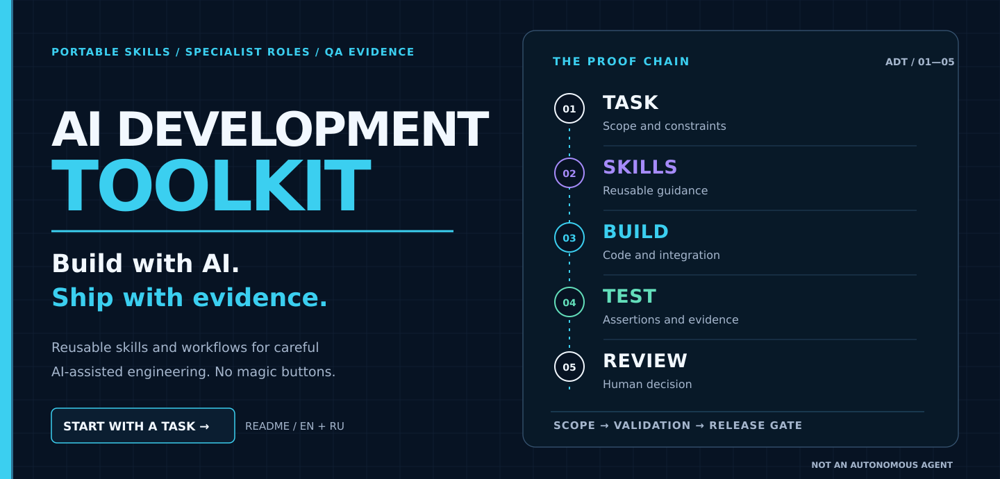
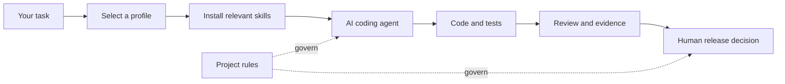

<div align="center">

[](docs/BEGINNER_START.md)

**English** · [Русский](README.ru.md)

[](https://github.com/MikeMoore1337/ai-development-toolkit/actions/workflows/validate.yml) · [Latest release](https://github.com/MikeMoore1337/ai-development-toolkit/releases/latest) · [Skills catalog](docs/SKILLS_CATALOG.md)

**[Start without a terminal](docs/BEGINNER_START.md)** · **[I have an existing project](docs/EXISTING_PROJECT.md)** · **[Local installation](#quick-start)** · **[Documentation](#documentation)**

</div>

**Already have a project?** Start with the [human-first guide](docs/EXISTING_PROJECT.md). The [coding agent contract](AGENT_START.md) is separate and is not required reading for a first request.

**Optional original [Graphify for local code navigation](docs/GRAPHIFY.md)** - opt-in, offline code-only, no runtime dependency.

**Toolkit integrations:** [ChatGPT plugin](integrations/chatgpt-plugin/README.md) · [Codex MCP](integrations/personal-mcp/README.md) · [Windows, Linux and macOS setup](docs/INTEGRATIONS.md) · [DeepSeek Chat](integrations/deepseek-chat/README.md) · [DeepSeek Harness](integrations/deepseek-harness/README.md)

**[Client choices, cost and permission boundaries](docs/CLIENT_ROUTE_SECURITY_MATRIX.md)** - what is actually tested, what requires consent, and how to keep personal settings private.

## Start with the task

AI Development Toolkit is a **portable library of reusable instructions, specialized roles and QA workflows** for AI-assisted development. It is not a standalone coding agent, hosting service or permission to access your project.

| You want to… | Start here | What to expect |
| :--- | :--- | :--- |
| **Describe an idea without using a terminal** | [Beginner guide](docs/BEGINNER_START.md) | Five copy-ready requests and honest limits for each AI client |
| **Work on an already-open project** | [I already have a project](docs/EXISTING_PROJECT.md) | Read relevant guidance before proposing changes; no Toolkit installation required just to use the reference |
| **Install and manage local skills** | [Safe installation](docs/INSTALLATION.md) | Profile selection, preview, explicit apply, status and rollback |

For a coding agent that **can actually access your existing project**, a useful first request is:

```text
Use https://github.com/MikeMoore1337/ai-development-toolkit
to complete this task in my current project. Inspect first,
select only the relevant skills, implement and report what was actually tested.
```

Toolkit is a **reference source, not an output directory for other users' code, logs or reports**. An agent may only modify your project with appropriate tools and permissions. Merely linking a repository does not activate skills or prove execution.

## What this looks like in practice

These are **illustrative workflows, not claimed real-world test runs**.

| Starting request | Relevant path | Check before calling it done |
| :--- | :--- | :--- |
| “Design a distinctive fitness-club website.” | [UX/UI Design Orchestra](docs/UX_UI_DESIGN.md): compare concepts, critique, present actual previews | Owner reviews the visuals **before** UI implementation |
| “Find and fix a failing API test.” | [QA Engineering Pack](docs/CURATED_SKILL_PACKS.md): reproduce, diagnose, make a focused change | Test results and the exact changed files are reported |
| “Help me prepare a release.” | [Release quality and gates](docs/RELEASE_PROCESS.md): risks, traceability, evidence | A human decides whether publication is authorized |

## What's inside?

**Reusable skills** for Frontend, Backend, Fullstack, QA, security, operations and UX/UI; **specialist roles**; and **task-focused profiles** for supported coding clients. [Explore the current catalog](docs/SKILLS_CATALOG.md) rather than relying on counts embedded in graphics. The [compatibility matrix](docs/CLIENT_COMPATIBILITY.md) distinguishes documented support from confirmed live execution.

[Curated engineering and QA packs](docs/CURATED_SKILL_PACKS.md) · [How skills are evaluated](docs/SKILL_EVALS.md) · [Make Feature](docs/MAKE_FEATURE_INTEGRATION.md) · [Clear Voice](docs/CLEAR_VOICE_INTEGRATION.md)

<details>
<summary>Inventory counters (automatically checked in CI)</summary>

[](docs/SKILLS_CATALOG.md)
[](docs/SKILLS_CATALOG.md)
[](docs/SKILLS_CATALOG.md)

| Group | Inventory |
| :--- | ---: |
| **Core skills** | 24 |
| **Frontend / Backend / Fullstack** | 14 |
| **QA Engineering Pack** | 27 |

</details>

## Local MCP for coding agents

**Fast start:** [Personal MCP - one-paste setup on Windows/Linux/macOS, plus ChatGPT/Codex local plugin marketplace](docs/ONE_COMMAND_SETUP.md). This reuses existing installers; public ChatGPT directory publication is a separate review.

[Install Toolkit MCP on Windows, Linux or macOS](docs/MCP_INSTALL.md) - project-scoped Codex / Claude Code integration, read-only skill discovery and explicit config approval. ChatGPT plugin installation is separate.

## Platform installation

**[Choose the AI client and interface](docs/INSTALLATION.md)** first: Codex Desktop/CLI/IDE/Cloud, Claude Code Desktop/CLI, ChatGPT/Claude chat, and other documented compatible coding clients. Then use the matching OS commands below.

[Windows](docs/INSTALL_WINDOWS.md) · [Linux](docs/INSTALL_LINUX.md) · [macOS (Apple Silicon / Intel)](docs/INSTALL_MACOS.md) · [Safe updates](docs/UPDATING.md)

All three platforms use the same Skill Manager; commands and Python launchers differ. macOS is tested on hosted CI runners, not a personal Mac or a live AI client.

## Quick start

**Local installation is optional.** You need Python 3.12+, a project directory and a separately installed AI client for the command-line route. Read [the no-terminal guide](docs/BEGINNER_START.md) if you only want to describe a task.


**Latest published release:** [v5.5.7](https://github.com/MikeMoore1337/ai-development-toolkit/releases/tag/v5.5.7). For technical checksums, commit SHAs and verification history see [CHANGELOG.md](CHANGELOG.md) and [release process](docs/RELEASE_PROCESS.md). Publishing Toolkit does not automatically update installed MCP or ChatGPT plugins.

For new installations, use **Skill Manager v2** to keep ownership records, preview changes, detect local edits, and support update, rollback and recovery.

```bash
# 1. Clone the existing repository
git clone https://github.com/MikeMoore1337/ai-development-toolkit.git
cd ai-development-toolkit

# 2. Browse profiles (read-only)
python scripts/skill_manager.py catalog

# 3. Preview changes (no files written)
python scripts/skill_manager.py install --target /path/to/your-project --profile general

# 4. Apply after reviewing the preview
python scripts/skill_manager.py install --target /path/to/your-project --profile general --apply

# 5. Inspect the managed installation
python scripts/skill_manager.py status --target /path/to/your-project
```

The default layout is Codex (`.agents/skills/`). For Claude Code, add `--layout claude` to install and status commands (`.claude/skills/`). Existing unmanaged skills and project `AGENTS.md` / `CLAUDE.md` are preserved. Install success proves a filesystem copy, **not** live client discovery or skill activation. Read [installation and safe updates](docs/INSTALLATION.md) for the legacy one-time copier, custom paths, diff previews, rollback and recovery.

<details>
<summary><strong>Windows / PowerShell example</strong></summary>

```powershell
python scripts/skill_manager.py install --target "C:\Work\my-app" --profile qa-python
python scripts/skill_manager.py install --target "C:\Work\my-app" --profile qa-python --apply
python scripts/skill_manager.py status --target "C:\Work\my-app"
```

</details>

## Choose your workflow

| Task | Suggested profile | More information |
| :--- | :--- | :--- |
| Implement an existing feature | `codex-feature` | [Feature workflows](docs/END_TO_END_WORKFLOW.md) |
| Frontend, backend or integration | `frontend` / `backend` / `fullstack` | [Engineering guide](docs/UNIVERSAL_ENGINEERING.md) |
| UX/UI exploration or redesign | `ui-orchestra` | [Design guide](docs/UX_UI_DESIGN.md) |
| Test design, flaky CI or release QA | `qa-python` / `qa-ci` / `qa-release` | [QA pack](docs/CURATED_SKILL_PACKS.md) |
| Security, accessibility and incidents | Task-specific profile | [All profiles](docs/SKILLS_CATALOG.md) |

See the [complete catalog](docs/SKILLS_CATALOG.md) and [safe client migration](docs/CLIENT_MIGRATION.md). Profiles select relevant instructions; they do not grant permissions or prove activation.

## How the parts fit



**Project-specific instructions and explicit approval gates always take precedence.** Do not enable `feature-delivery` and `make-feature` as simultaneous controllers for the same task. Validation of a skill's metadata is not evidence of its safety or performance in a real agent session.

## Validate the collection

```bash
python -m pip install -r requirements-dev.txt
python scripts/validate_pack.py
python scripts/check_public_package.py
python -m unittest discover -s tests -v
```

The existing required Ubuntu/Python 3.12 CI job additionally runs the official
[Agent Skills reference validator](docs/AGENT_SKILLS_SPEC.md) on every
manifest-declared skill (the current manifest-defined inventory), including QA, Make Feature and engineering extensions. Local
reproduction in an isolated virtual environment:

```bash
python -m pip install "git+https://github.com/agentskills/agentskills.git@69ef37e9424c0a7ea9dd2293b559e43ec8176379#subdirectory=skills-ref"
python scripts/validate_with_skills_ref.py --scope all
```

The CLI is installed from the pinned upstream source, **not** the unrelated
PyPI package. Neither metadata validation nor these tests proves real-agent
effectiveness, execution safety or client compatibility.

## Documentation

- [Start without a terminal](docs/BEGINNER_START.md) - choose Codex, ChatGPT, Claude Code or Claude and copy a request
- [Four verified offline examples](docs/VERIFIED_EXAMPLES.md) - reproducible source-only commands, with explicit evidence limits
- [Full skills & roles catalog](docs/SKILLS_CATALOG.md) - discover exactly what's included
- [Installation](docs/INSTALLATION.md) - safety, options and client layouts
- [Adaptation guide](docs/ADAPTATION.md) - apply skills to an existing project
- [Quality rubric](docs/QUALITY_RUBRIC.md) - evaluate usefulness and risk
- [Skill Evals (experimental)](docs/SKILL_EVALS.md) - score paired trials without inventing outcomes
- [Real-agent pilot protocol](docs/REAL_AGENT_PILOT.md) - opt-in Codex/Claude CLI experiments; no real results published yet
- [Publication policy](docs/PUBLICATION_POLICY.md) - provenance, licensing and private data
- [Roadmap](docs/ROADMAP.md) - planned improvements, not shipped features

## Contributing

Ideas, corrections, portability reports and focused skill contributions are welcome. Read [CONTRIBUTING.md](CONTRIBUTING.md) before submitting a PR; report sensitive issues via [SECURITY.md](SECURITY.md).

Core files are MIT-licensed. Some bundled material has separate author credits and notices, including Make Feature. See each component's license and [publication policy](docs/PUBLICATION_POLICY.md). This repository is community tooling and is **not** an official distribution of Codex, Claude Code or Agent Skills.

**Distribution rights:** Provenance is recorded in [the audit](docs/PROVENANCE_AUDIT.md) and [registry](provenance/skills.json). Owner reports permission under ID1337 for the current Make Feature, QA and branding files; their byte hashes are frozen in the registry. Independent legal verification is **not claimed**. A new release requires separate owner sign-off for its exact artifact. A passing CI run does not establish publication rights.
