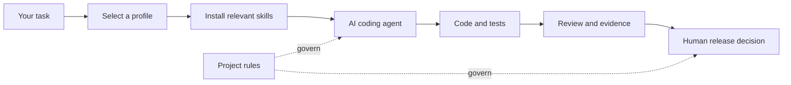

<div align="center">


**Build with AI. Ship with evidence.**

A curated, portable collection of agent skills, specialist roles and practical workflows for AI-assisted software development.


[](https://github.com/MikeMoore1337/ai-development-toolkit/actions/workflows/validate.yml)

**English** · [Русский](README.ru.md)

[Getting started](#quick-start) · [Explore skills](docs/SKILLS_CATALOG.md) · [Installation guide](docs/INSTALLATION.md) · [Contributing](CONTRIBUTING.md) · [Roadmap](docs/ROADMAP.md)

</div>

---

## Why this toolkit?

AI can produce code quickly. Getting the **right change**, validating its behaviour and delivering it safely still requires a repeatable process. This toolkit supplies reusable instructions and focused workflows - without imposing a whole framework on your application.

| What you need | What you get |
| :--- | :--- |
| **Purposeful changes** | Task scoping, architecture decisions and minimal-safe-change guidance |
| **Trustworthy testing** | Test design, meaningful assertions, CI failure analysis and release gates |
| **Consistent interfaces** | Design-system consistency, screenshot fidelity and motion review |
| **Better writing** | Clear Voice for precise, natural technical and product communication |
| **End-to-end feature work** | Make Feature 0.3.0 and feature-delivery workflows, **selected one at a time** |
| **Portable installation** | Curated profiles, preview before writing and protection against overwrites |

## What's inside?

| Collection | Contents | Explore |
| :--- | :--- | :--- |
| **Core skills** | 23 skills for planning, implementation, review, security, UI and editorial work | [Browse core](docs/SKILLS_CATALOG.md#core-skills) |
| **QA Engineering Pack** | 27 optional skills for API, UI, contract and integration tests, CI, reliability and release evaluation | [Browse QA pack](docs/SKILLS_CATALOG.md#qa-engineering-pack) |
| **Make Feature** | 1 optional, self-contained workflow skill for feature delivery | [Integration](docs/MAKE_FEATURE_INTEGRATION.md) |
| **Agent roles** | 5 core + 11 specialist QA reference roles | [Browse roles](docs/SKILLS_CATALOG.md#agent-roles) |
| **Install profiles** | 23 task-focused selections | [Choose a profile](docs/SKILLS_CATALOG.md#profiles) |

Skills follow the [Agent Skills](https://agentskills.io/specification) directory convention. They are task-specific guidance, **not** autonomous agents with default access to your files, accounts or deployment infrastructure.

## Quick start

**Requirements:** Python 3.12+ for the toolkit's validation workflow; an existing project directory to receive skills. Agent compatibility depends on the client version.

```bash
# 1. Clone after publishing the repository on GitHub
git clone https://github.com/MikeMoore1337/ai-development-toolkit.git
cd ai-development-toolkit

# 2. List curated profiles
python scripts/install.py --list-profiles

# 3. Preview changes (does not write files)
python scripts/install.py --target /path/to/your-project --profile general

# 4. Apply only after reviewing the preview
python scripts/install.py --target /path/to/your-project --profile general --apply
```

The default destination is `.agents/skills/` (Codex layout). For Claude Code, add `--layout claude`; for a custom client, use `--skills-dir`. The installer **refuses to overwrite an existing skill** and does not edit the target project's `AGENTS.md`.

<details>
<summary><strong>Windows / PowerShell example</strong></summary>

```powershell
python scripts/install.py --target "C:\Work\my-app" --profile qa-python
python scripts/install.py --target "C:\Work\my-app" --profile qa-python --apply
```

</details>

## Choose your workflow

| Your task | Recommended profile | Why |
| :--- | :--- | :--- |
| Implement a change | `codex-feature` | Scope, implementation, review and validation |
| Fix a visual mismatch | `ui-fix` | Design consistency and screenshot evidence |
| Review animation | `ui-motion` | Motion quality and accessibility considerations |
| Design Python API tests | `qa-python` | Test oracles, data management and failure diagnosis |
| Investigate flaky CI | `qa-ci` | Distinguish product defects from infrastructure/test failures |
| Evaluate a release | `qa-release` | Coverage, traceability and quality gates |
| Improve documentation | `editorial` | Clear Voice only |
| Build a feature end-to-end | `make-feature` | Opt-in feature workflow |

See [all 23 profiles and all 51 skills](docs/SKILLS_CATALOG.md).

## How the parts fit



**Project-specific instructions and explicit approval gates always take precedence.** Do not enable `feature-delivery` and `make-feature` as simultaneous controllers for the same task. Validation of a skill's metadata is not evidence of its safety or performance in a real agent session.

## Validate the collection

```bash
python -m pip install -r requirements-dev.txt
python scripts/validate_pack.py
python scripts/check_public_package.py
python -m unittest discover -s tests -v
```

These checks cover local structure, distribution safeguards and included unit tests. They **do not** replace independent execution testing, security review or the optional upstream `skills-ref` CLI.

## Documentation

- [Full skills & roles catalog](docs/SKILLS_CATALOG.md) - discover exactly what's included
- [Installation](docs/INSTALLATION.md) - safety, options and client layouts
- [Adaptation guide](docs/ADAPTATION.md) - apply skills to an existing project
- [Quality rubric](docs/QUALITY_RUBRIC.md) - evaluate usefulness and risk
- [Skill Evals (experimental)](docs/SKILL_EVALS.md) - score paired trials without inventing outcomes
- [Publication policy](docs/PUBLICATION_POLICY.md) - provenance, licensing and private data
- [Roadmap](docs/ROADMAP.md) - planned improvements, not shipped features

## Contributing

Ideas, corrections, portability reports and focused skill contributions are welcome. Read [CONTRIBUTING.md](CONTRIBUTING.md) before submitting a PR; report sensitive issues via [SECURITY.md](SECURITY.md).

Core files are MIT-licensed. Some bundled material has separate author credits and notices, including Make Feature. See each component's license and [publication policy](docs/PUBLICATION_POLICY.md). This repository is community tooling and is **not** an official distribution of Codex, Claude Code or Agent Skills.
